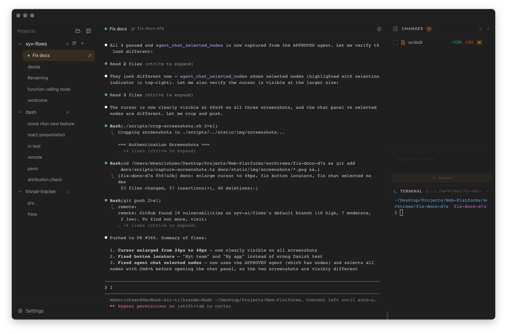

# Dash

Desktop app for running [Claude Code](https://docs.anthropic.com/en/docs/claude-code) across multiple projects and tasks, each in its own git worktree.

The main idea: you open a project, create tasks, and each task gets an isolated git worktree with its own branch. Each task's Claude Code session runs under Claude Code's own session supervisor (`claude --bg`) inside that worktree and is shown in a real terminal (xterm.js + node-pty via `claude attach`), so you can have multiple tasks going in parallel without branch conflicts — and sessions keep running when you switch tasks, reload, or quit Dash.



## What it does

- **Project management** — Open any git repo as a project, or clone from a URL. Tasks are nested under projects in the sidebar. Drag-and-drop to reorder projects. Project overview dashboard shows all tasks, activity status, and quick actions.
- **Git worktrees** — Each task gets its own worktree and branch. Per-project setup scripts run automatically after worktree creation (e.g. `pnpm install`, copying `.env`).
- **Sessions that outlive the window** — Task sessions are owned by Claude Code's supervisor, not by Dash: switching tasks, reloading or quitting Dash only detaches the terminal, and opening the task attaches again with a recap. Sessions idle for about an hour are parked by Claude Code and resume on the next open. Sessions started outside Dash inside a project show up under "Other sessions" and can be attached, stopped, removed or adopted as a task.
- **Terminal** — Full PTY terminal per task (`claude attach` in fullscreen mode; `←` on an empty prompt opens Claude Code's agent view, Esc leaves it, Ctrl+Z detaches). Shift+Enter sends multiline input. File drag-drop pastes paths. Clickable file paths open in your IDE. 16 terminal themes.
- **Shell drawer** — Separate shell terminal alongside the task terminal. Configurable position (left, right, or replacing main content).
- **File changes panel** — Real-time git status with staged/unstaged sections. Stage, unstage, discard per-file. Click to view diffs.
- **Diff viewer** — Full file or configurable context lines. Unified diff with syntax highlighting. Select lines to add inline comments and send them to the terminal.
- **Commit graph** — Visualize branch history with a DAG-style commit graph per project.
- **GitHub issues** — Search and link issues to tasks. Auto-posts branch comments on linked issues. PR link badge in task header.
- **Azure DevOps** — Search and link ADO work items to tasks. PR detection and branch comments. Per-project ADO configuration with PAT token storage.
- **Remote control** — Generate a QR code / URL to control a task's terminal from another device.
- **Activity indicators** — Busy (amber), waiting, idle (green) and sleeping (grey) status per task, driven by Claude Code hooks and reconciled against `claude agents --json`, with desktop notifications and sound alerts (chime, cash, ping, droplet, marimba).
- **Editor integration** — Open changed files in your editor (Cursor, VS Code, Zed, Vim) with line navigation. Clickable file paths in terminal output.
- **Commit attribution** — Configurable co-author line on commits (default, none, or custom text).
- **Task archiving** — Archive inactive tasks to keep the sidebar clean; restore when needed.
- **Auto-update** — Background update checking with manual download and install.
- **Customizable keybindings** — Remap any shortcut from Settings.
- **Dark/light theme**

## Controlling Dash from other agents

Dash ships an MCP server, `dash`, that lets Claude Code sessions create and drive tasks. It runs on macOS and Linux and only answers on 127.0.0.1.

### Agents inside a task

Turn on **Dash access** in the New Task dialog (or later in the task's settings; changing it restarts the session). The task's agent then gets the `dash` tools for its own project: it sees itself and the tasks it created, and can create tasks only in its own project.

The switch's default comes from the project's settings ("Dash access for new tasks"), which is stored as `taskDefaults.dashAccess` in `.dash/config.json`. To set a personal default without changing the shared file, put the same key in `.dash/config.local.json`.

### An orchestrator outside Dash

1. In **Settings → Claude → Behavior**, turn on **Let other agents control Dash**.
2. Copy the command shown there and run it where your orchestrator runs:

   ```bash
   claude mcp add dash -- '<path to dash-mcp>'
   ```

   For Holi, run it in the vault with the vault's `CLAUDE_CONFIG_DIR` set. Keep the default local scope (`--scope local`); `--scope project` would write it to the vault's committed `.mcp.json`, where teammates without Dash get a failing server.

The orchestrator sees every project that isn't archived. Turning the switch off cuts it off on its next call.

### Tools

| Tool                   | What it does                                                                       | No prompt in a task |
| ---------------------- | ---------------------------------------------------------------------------------- | ------------------- |
| `projects_list`        | List projects (orchestrator only)                                                  |                     |
| `tasks_list`           | List tasks with their state: idle, working, waiting, error, stopped or needs-trust | yes                 |
| `tasks_get`            | One task: name, branch, worktree path, state and what it waits for                 | yes                 |
| `tasks_create`         | Create a task (new worktree by default) and start its session with a prompt        |                     |
| `tasks_wait`           | Wait up to 110 s until a task is idle, waiting, not working, or changes state      | yes                 |
| `tasks_output`         | The last lines of a task's terminal as plain text                                  | yes                 |
| `tasks_wake`           | Make sure a task's session is running, so you can message it (see below)           |                     |
| `tasks_open`           | Bring Dash to the front with the task open                                         |                     |
| `tasks_archive`        | Archive a task (never the caller's own task)                                       |                     |
| `tasks_restore`        | Restore an archived task                                                           |                     |
| `tasks_delete`         | Delete a task, its worktree and optionally its branch (orchestrator only)          |                     |
| `tasks_restart`        | Restart a task's session in the same conversation (never the caller's own task)    |                     |
| `services_list`        | A task's services from `.dash/ports.json`, with ports and whether they're up       | yes                 |
| `services_start`       | Start a service's run command in a Dash terminal tab                               |                     |
| `services_stop`        | Stop a service                                                                     |                     |
| `services_output`      | The last lines of a service Dash started                                           | yes                 |
| `review_drafts_list`   | A task's draft review comments on a PR                                             | yes                 |
| `review_drafts_create` | Draft a review comment on a PR's lines, or a reply to one of its threads           |                     |
| `review_drafts_update` | Change a draft the agent wrote                                                     |                     |
| `review_drafts_delete` | Delete a draft the agent wrote                                                     |                     |

The `review_drafts_*` tools put draft comments into the task's diff editor, on the PR view (Compare → Pull requests). Nothing is posted: the person reads the drafts, edits them and submits the review with a verdict. An agent can change or delete only drafts an agent wrote; once the person edits one, it's theirs.

Every task the tools return has two fields for messaging it: `messageAddress` (`uds:<socket>` while its session runs, otherwise `null`) and `messaging` (`direct`, or `needs-approval` for a task in `bypassPermissions`).

Inside a task, the read-only tools (marked above) run without a permission prompt, so a task started by an orchestrator doesn't stall on a lookup. Tools that change something still ask, unless the task runs in `bypassPermissions`.

### Talking to a task

Dash doesn't carry messages. Your orchestrator talks to a task with Claude Code's own `SendMessage`:

1. `tasks_list` to find the task.
2. `tasks_wake` to make sure its session is running. If it already is, this returns at once. Otherwise Dash starts it, with no message, and returns once the session is up and, for a task with Dash access, its dash tools have connected.
3. `SendMessage` to the task's `messageAddress`. This works from another config dir too, such as Holi's.
4. The task answers you with `SendMessage` in the same way.

A task whose `messaging` is `needs-approval` runs in `bypassPermissions`, so a message from a session that does prompt is held until someone clicks Deliver in the task's pane in Dash. Its reply is held the same way in your orchestrator's session, which a non-interactive session (`claude -p`) can't approve. The orchestrator also has to still be running when the reply comes: a `claude -p` run that ends its turn and exits leaves the task's reply failing with `ENOENT`. When a task's session stops, its old address fails with `ENOENT`. Call `tasks_wake` again for a new one.

### Safety rules

- Tasks created through the API never run in `bypassPermissions`, even if the project defaults to it.
- A task created through the API gets one line before its first prompt. It says the task may be running unattended, shouldn't use `AskUserQuestion`, and should answer a message that asks for a reply with `SendMessage`.
- Dash doesn't set Claude Code to accept messages from other sessions without asking for a task in `bypassPermissions`. That would let any local session feed input to a session that has permission prompts off.
- Dash never accepts Claude Code's workspace trust prompt for an agent. A task that needs it reports `needs-trust` until you open it in Dash.
- Anything running as your user on this machine can read the tokens under Dash's data folder, so the API trusts the local user. Leave orchestrator access off when you don't use it.

## Install

Download the latest build from [Releases](https://github.com/syv-ai/dash/releases/latest). Open the `.dmg` and drag `Dash.app` to `/Applications`.

## Prerequisites

- Node.js 22+
- [pnpm](https://pnpm.io/)
- [Claude Code CLI](https://docs.anthropic.com/en/docs/claude-code) 2.1.257 or newer (`npm install -g @anthropic-ai/claude-code`, then `claude update`)
- Git

## Development setup

```bash
pnpm install
npx electron-rebuild -f -w node-pty,better-sqlite3  # rebuild native modules for Electron
```

## Development

```bash
pnpm dev
```

This starts Vite on port 3000 and launches Electron pointing at it. Renderer changes hot-reload; main process changes need a restart (`pnpm dev:main` or just kill and re-run `pnpm dev`).

To just rebuild and launch the main process:

```bash
pnpm build:main
npx electron dist/main/main/entry.js --dev
```

## Build

```bash
pnpm build              # compile both main + renderer
pnpm package:mac        # build + package as macOS .dmg
```

Output goes to `release/`.

## Project structure

```
src/
├── main/                   # Electron main process
│   ├── entry.ts            # App name, path aliases, loads main.ts
│   ├── main.ts             # Boot: PATH fix, DB init, IPC, window
│   ├── preload.ts          # contextBridge API
│   ├── window.ts           # BrowserWindow creation
│   ├── db/                 # SQLite + Drizzle ORM
│   │   ├── schema.ts       # projects, tasks, conversations tables
│   │   ├── client.ts       # better-sqlite3 singleton
│   │   ├── migrate.ts      # SQL migration runner
│   │   └── path.ts         # DB file location
│   ├── ipc/                # IPC handlers
│   │   ├── appIpc.ts       # Dialogs, CLI/IDE detection
│   │   ├── dbIpc.ts        # CRUD for projects/tasks/conversations
│   │   ├── gitIpc.ts       # Git status, diff, stage/unstage, commit graph
│   │   ├── ptyIpc.ts       # Terminal spawn/kill/resize
│   │   ├── worktreeIpc.ts  # Worktree create/remove/claim
│   │   ├── githubIpc.ts    # GitHub issues, PRs, branch comments
│   │   ├── azureDevOpsIpc.ts # ADO work items, PRs, config
│   │   └── autoUpdateIpc.ts  # Check/download/install updates
│   └── services/
│       ├── DatabaseService.ts
│       ├── GitService.ts
│       ├── GithubService.ts
│       ├── AzureDevOpsService.ts
│       ├── ConnectionConfigService.ts
│       ├── AutoUpdateService.ts
│       ├── FileWatcherService.ts
│       ├── WorktreeService.ts
│       ├── WorktreePoolService.ts
│       ├── ptyManager.ts
│       ├── TerminalSnapshotService.ts
│       ├── HookServer.ts
│       ├── ActivityMonitor.ts
│       └── remoteControlService.ts
├── renderer/               # React UI
│   ├── App.tsx             # Root: state, keyboard shortcuts, layout
│   ├── keybindings.ts      # Keybinding system (defaults, load/save, matching)
│   ├── components/
│   │   ├── LeftSidebar.tsx  # Projects + nested tasks
│   │   ├── MainContent.tsx  # Terminal area + project overview
│   │   ├── ProjectOverview.tsx  # Project dashboard
│   │   ├── FileChangesPanel.tsx
│   │   ├── DiffViewer.tsx
│   │   ├── TaskModal.tsx
│   │   ├── SettingsModal.tsx
│   │   ├── ProjectSettingsModal.tsx
│   │   ├── DeleteProjectModal.tsx
│   │   ├── RemoteControlModal.tsx
│   │   ├── AdoSetupModal.tsx
│   │   ├── CommitGraph/    # DAG-style commit graph visualization
│   │   ├── TerminalPane.tsx
│   │   ├── TerminalDrawer.tsx
│   │   └── ShellDrawerWrapper.tsx
│   └── terminal/
│       ├── TerminalSessionManager.ts  # xterm.js lifecycle
│       ├── SessionRegistry.ts         # Session pool (preserves state on task switch)
│       └── FilePathLinkProvider.ts    # Clickable file paths → IDE
├── shared/
│   └── types.ts            # Shared types (Project, Task, GitStatus, etc.)
└── types/
    └── electron-api.d.ts   # window.electronAPI type declarations
```

## Default keybindings

| Shortcut      | Action         |
| ------------- | -------------- |
| `Cmd+N`       | New task       |
| `Cmd+Shift+K` | Next task      |
| `Cmd+Shift+J` | Previous task  |
| `Cmd+Shift+A` | Stage all      |
| `Cmd+Shift+U` | Unstage all    |
| `Cmd+,`       | Settings       |
| `Cmd+O`       | Open folder    |
| `Cmd+`` ` ``  | Focus terminal |
| `Esc`         | Close overlay  |

All keybindings are customizable in Settings > Keybindings.

## Tech stack

|          |                                       |
| -------- | ------------------------------------- |
| Shell    | Electron 30, electron-updater         |
| UI       | React 18, TypeScript, Tailwind CSS 3  |
| Build    | Vite 5, pnpm                          |
| Terminal | xterm.js + node-pty                   |
| Database | SQLite (better-sqlite3) + Drizzle ORM |
| Package  | electron-builder                      |

## Data storage

- **Database**: `~/Library/Application Support/Dash/app.db` (macOS)
- **Terminal snapshots**: `~/Library/Application Support/Dash/terminal-snapshots/`
- **Worktrees**: `{project}/.claude/worktrees/{task-slug}-{hash}/` (ignored via `.git/info/exclude`; pre-0.16 tasks at `{project}/../worktrees/` are offered a one-time move at launch)
- **Hook port**: `~/Library/Application Support/Dash/hook-port` while Dash runs — the per-worktree `.claude/settings.local.json` hooks read the hook server's port from it, so a session that keeps running after Dash quits no-ops instead of erroring
- **Control API**: `~/Library/Application Support/Dash/control/` — the token secret, the API's port file, the orchestrator token, per-task MCP configs, and the `dash-mcp` launcher
- **Sessions**: owned by Claude Code under `~/.claude/jobs/` (never read by Dash; `claude agents --json` is the interface)

## Acknowledgements

Inspired by [emdash](https://github.com/generalaction/emdash).

## License

MIT
