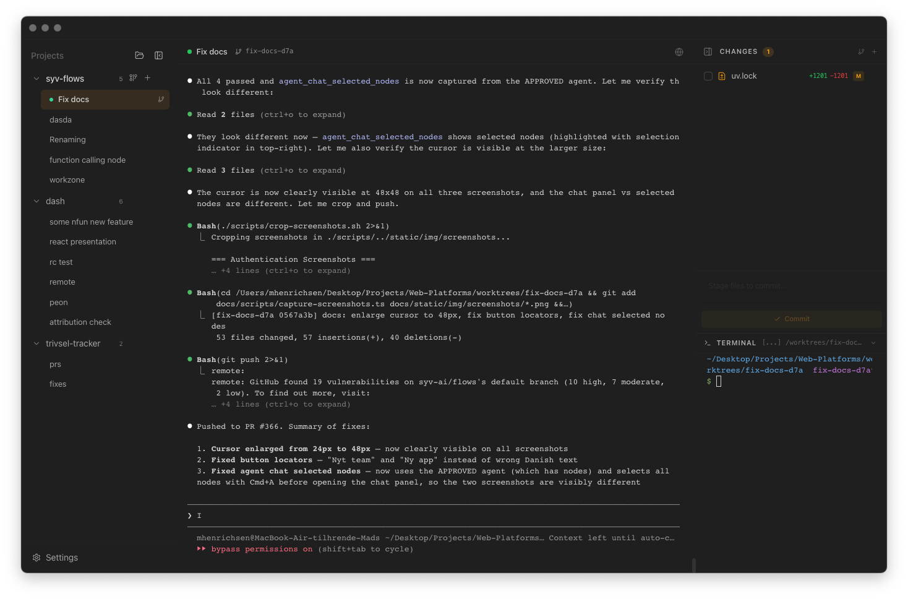

# Dash

Desktop app for running [Claude Code](https://docs.anthropic.com/en/docs/claude-code) across multiple projects and tasks, each in its own git worktree.

The main idea: you open a project, create tasks, and each task gets an isolated git worktree with its own branch. Each task's Claude Code session runs under Claude Code's own session supervisor (`claude --bg`) inside that worktree and is shown in a real terminal (xterm.js + node-pty via `claude attach`), so you can have multiple tasks going in parallel without branch conflicts — and sessions keep running when you switch tasks, reload, or quit Dash.



## What it does

- **Project management** — Open any git repo as a project, or clone from a URL. Tasks are nested under projects in the sidebar. Drag-and-drop to reorder projects. Project overview dashboard shows all tasks, activity status, and quick actions.
- **Git worktrees** — Each task gets its own worktree and branch. Per-project setup scripts run automatically after worktree creation (e.g. `pnpm install`, copying `.env`).
- **Sessions that outlive the window** — Task sessions are owned by Claude Code's supervisor, not by Dash: switching tasks, reloading or quitting Dash only detaches the terminal, and opening the task attaches again with a recap. Sessions idle for about an hour are parked by Claude Code and resume on the next open. Sessions started outside Dash inside a project show up under "Other sessions" and can be attached, stopped, removed or adopted as a task.
- **Terminal** — Full PTY terminal per task (`claude attach` in fullscreen mode; `←` on an empty prompt opens Claude Code's agent view, Esc leaves it, Ctrl+Z detaches). Shift+Enter sends multiline input. File drag-drop pastes paths. Clickable file paths open in your IDE. 16 terminal themes.
- **Shell drawer** — Separate shell terminal alongside the task terminal. Configurable position (left, right, or replacing main content).
- **File changes panel** — Real-time git status with staged/unstaged sections. Stage, unstage, discard per-file. Click to view diffs.
- **Diff viewer** — Full file or configurable context lines. Unified diff with syntax highlighting. Select lines to add inline comments and send them to the terminal.
- **Commit graph** — Visualize branch history with a DAG-style commit graph per project.
- **GitHub issues** — Search and link issues to tasks. Auto-posts branch comments on linked issues. PR link badge in task header.
- **Azure DevOps** — Search and link ADO work items to tasks. PR detection and branch comments. Per-project ADO configuration with PAT token storage.
- **Remote control** — Generate a QR code / URL to control a task's terminal from another device.
- **Activity indicators** — Busy (amber), waiting, idle (green) and sleeping (grey) status per task, driven by Claude Code hooks and reconciled against `claude agents --json`, with desktop notifications and sound alerts (chime, cash, ping, droplet, marimba).
- **Editor integration** — Open changed files in your editor (Cursor, VS Code, Zed, Vim) with line navigation. Clickable file paths in terminal output.
- **Commit attribution** — Configurable co-author line on commits (default, none, or custom text).
- **Task archiving** — Archive inactive tasks to keep the sidebar clean; restore when needed.
- **Auto-update** — Background update checking with manual download and install.
- **Customizable keybindings** — Remap any shortcut from Settings.
- **Dark/light theme**

## Controlling Dash from other agents

Dash ships a command line, `dashctl`, that lets Claude Code sessions create and drive tasks. It runs on macOS and Linux and only talks to Dash on 127.0.0.1.

```bash
dashctl help                              # every command
dashctl tasks create "Fix the flaky test" --project dash --prompt - <<'PROMPT'
The login test fails one run in five on CI. Find out why and fix it.
PROMPT
dashctl tasks wait <task-id> --until idle
dashctl tasks output <task-id> --lines 80
dashctl review drafts-create --help       # one command's flags
```

Dash writes it to `control/bin/dashctl` in its data folder each time it starts. It is a small `sh` + `curl` script that hands its words to Dash, which owns the commands, so an older copy still runs the newest Dash's (all but `tasks watch`, which streams: an older copy gets a refusal). `--project` takes a project's name, id or path (relative to where you run it): the project's folder, one inside it, or a git worktree of it. `dashctl version` prints Dash's version and whether it is a packaged build, as `{"version":"0.22.0","packaged":true}` (`false` for a dev run). A comment body comes on stdin; any input that can come on stdin does when given as `-`, like `--prompt -` above. Results are JSON on stdout (`tasks watch`: one JSON line per change, as it happens); a usage error (bare `dashctl` too) exits 2 and a refusal exits 1, both on stderr. An answer cut off exits 1; so does a stream that ends on an `{"error":…}` line or because Dash quit. A stopped `tasks watch` exits 128 + the signal (143 for SIGTERM).

### Agents inside a task

Turn on **Dash access** in the New Task dialog (or later in the task's settings; changing it restarts the session). The task's agent can then run `dashctl` for its own project: it sees itself and the tasks it created, and can create tasks only in its own project.

Dash puts it all in the task's `--settings` file, rewritten at every session start: the task's caller id and token in `env`, a SessionStart hook that appends `dashctl`'s folder to `PATH` (through `CLAUDE_ENV_FILE`), and allow rules for the read-only commands. It also writes a `dash` skill to `.claude/skills/dash/SKILL.md` in the task's checkout. It explains `dashctl`, above all the PR review workflow (notes vs comments, where a draft goes, the review summary), and names `dashctl`'s full path in case a session's `PATH` lacks it. It is kept out of git through `.git/info/exclude`, not the repo's `.gitignore`, and removed when Dash access is turned off. A `dash` skill the repo already has, without Dash's marker, is left alone.

Every task, Dash access or not, also gets a `dash-feedback` skill (`.claude/skills/dash-feedback/`, kept out of git the same way). When the agent misses something in Dash, finds a Dash skill unclear, or its user has something to say about Dash itself, it drafts a GitHub issue on this repository for the user to submit, through the **Agent feedback** issue form, or with `gh` when asked. Nothing from the user's project goes in it: the repository is public.

The switch's default comes from the project's settings ("Dash access for new tasks"), which is stored as `taskDefaults.dashAccess` in `.dash/config.json`. To set a personal default without changing the shared file, put the same key in `.dash/config.local.json`.

### An orchestrator outside Dash

In **Settings → Claude → Behavior**, turn on **Let other agents control Dash**. That's all: `dashctl` finds Dash's port and the orchestrator token by itself. Settings shows `dashctl`'s path to run it by; in a Holi vault, the Dash plugin (`syv-ai/holi-plugins`, folder `dash`) puts it on the agent's `PATH`.

The orchestrator sees every project that isn't archived. Turning the switch off cuts it off on its next call.

### Commands

| Command                     | What it does                                                                       | No prompt in a task |
| --------------------------- | ---------------------------------------------------------------------------------- | ------------------- |
| `projects list`             | List projects (orchestrator only)                                                  |                     |
| `projects add <path>`       | Open a folder already on this machine as a project (orchestrator only)             |                     |
| `tasks list`                | List tasks with their state: idle, working, waiting, error, stopped or needs-trust | yes                 |
| `tasks get <task-id>`       | One task: name, branch, worktree path, state and what it waits for                 | yes                 |
| `tasks create <name>`       | Create a task (new worktree by default) and start its session with a prompt        |                     |
| `tasks link <task-id>`      | Link a GitHub issue or ADO work item to a task (also `tasks create --issue`)       |                     |
| `tasks wait <task-id>`      | Wait up to 110 s until a task is idle, waiting, not working, or changes state      | yes                 |
| `tasks watch [task-id]`     | Print a JSON line per task change until stopped; meant to run in the background    | yes                 |
| `tasks output <task-id>`    | The last lines of a task's terminal as plain text                                  | yes                 |
| `tasks wake <task-id>`      | Make sure a task's session is running                                              |                     |
| `tasks message <task-id>`   | Send a task's session a message (body on stdin), starting it if stopped            |                     |
| `tasks reply <task-id>`     | A task's reply to a message, from its transcript (`--message-id`)                  | yes                 |
| `tasks open <task-id>`      | Bring Dash to the front with the task open                                         |                     |
| `tasks archive <task-id>`   | Archive a task (never the caller's own task)                                       |                     |
| `tasks restore <task-id>`   | Restore an archived task                                                           |                     |
| `tasks delete <task-id>`    | Delete a task, its worktree and optionally its branch (orchestrator only)          |                     |
| `tasks restart <task-id>`   | Restart a task's session in the same conversation (never the caller's own task)    |                     |
| `services list`             | A task's services from `.dash/ports.json`, with ports and whether they're up       | yes                 |
| `services start <label>`    | Start a service's run command in a Dash terminal tab                               |                     |
| `services stop <label>`     | Stop a service                                                                     |                     |
| `services output <label>`   | The last lines of a service Dash started                                           | yes                 |
| `review drafts-list`        | A task's notes and draft review comments on a PR                                   | yes                 |
| `review drafts-create`      | Write a note, or draft a review comment on a PR's lines or a reply to a thread     |                     |
| `review drafts-update <id>` | Change a note or draft, the person's or the agent's (`--body -` reads stdin)       |                     |
| `review drafts-delete <id>` | Delete a note or draft, the person's or the agent's                                |                     |
| `review summary-get`        | A task's draft review summary for a PR (its PR-level comment)                      | yes                 |
| `review summary-set`        | Draft the review summary, posted with the verdict on Submit                        |                     |

The `review` commands put notes and draft comments into the task's diff editor, on the PR view (Compare → Pull requests). A comment is for the PR's author; a note is for the developer and stays local (the person can promote it). Nothing is posted: the person reads the drafts, edits them and submits the review with a verdict. An agent can change or delete any of the task's notes and drafts, the person's too; the person sees every change before submitting.

Every task the commands return has two fields for messaging it with Claude Code's `SendMessage`: `messageAddress` (`uds:<socket>` while its session runs, otherwise `null`) and `messaging` (`direct`, or `needs-approval` for a task in `bypassPermissions`).

Inside a task, the read-only commands (marked above) run without a permission prompt, so a task started by an orchestrator doesn't stall on a lookup. Commands that change something ask in the default and accept-edits modes; in auto mode (the default) Claude Code's classifier can approve them on its own, and in `bypassPermissions` nothing asks.

### Talking to a task

An orchestrator on any harness (Claude Code, Codex, Pi, a script) talks to a task through Dash, with no one opening Dash:

1. `dashctl tasks list` to find the task.
2. `dashctl tasks message <task-id>` with the message on stdin. A stopped session is started first. Dash writes the message once into the session's own inbox, so it works for a task in `bypassPermissions` too. The task sees a header line naming the sender (`--from`, default "an orchestrator") and the message id.
3. `dashctl tasks reply <task-id> --message-id <id>` reads the answer: the task's last message of the turn the message started. `status` is `pending` until the task stops working, then `done`.

To follow tasks without polling, keep `dashctl tasks watch` running in the background (Claude Code's `run_in_background` or Monitor): it prints each task's view, then a `{"event":"task",…}` line whenever one changes and `{"event":"removed",…}` when one is archived or deleted. A task messaged since the watch started also gives a `{"event":"reply","messageId":…,"text":…}` line once it has answered, so you don't need `tasks reply`. Give a task id to watch just that task; it then ends once the task is removed. A watch also ends, on an `{"error":…}` line, once the caller's access is turned off.

An idle task starts a turn with the message. A working one reads it after the tool call in flight; the result then says `queued: true`, and the reply may be mixed with the turn's other work. Never send a message again after an error that says it may have been delivered: a message sent twice is a turn taken twice. Message ids live in Dash's memory, so `tasks reply` can't find one after Dash restarts. A task whose session started before this version of Dash has no inbox known: `dashctl tasks restart <task-id>` (same conversation) fixes it.

Claude Code's own `SendMessage` to a task's `messageAddress` still works too. A task whose `messaging` is `needs-approval` runs in `bypassPermissions`, so such a message is held until someone clicks Deliver in the task's pane in Dash, and a stopped session's old address fails with `ENOENT`.

### Safety rules

- Tasks created through the API never run in `bypassPermissions`: a project that defaults to it gives them auto mode instead.
- A task created through the API gets one line before its first prompt. It says the task may be running unattended, shouldn't use `AskUserQuestion`, and that the reply to a message from an orchestrator through Dash is its last message of that turn.
- Dash doesn't set Claude Code to accept messages from other sessions without asking for a task in `bypassPermissions`. That would let any local session feed input to a session that has permission prompts off. `dashctl tasks message` is delivered with the task's own inbox token instead, which only Dash holds (in memory), so only a caller Dash lets in (the orchestrator token, or a task with Dash access acting on a task it created) gets a message to a task that way. Claude Code still tells the task the message came from another session, so it can't approve anything on the person's behalf.
- Dash never accepts Claude Code's workspace trust prompt for an agent. A task that needs it reports `needs-trust` until you open it in Dash.
- Anything running as your user on this machine can read the tokens under Dash's data folder, so the API trusts the local user. Leave orchestrator access off when you don't use it.

## Install

Download the latest build from [Releases](https://github.com/syv-ai/dash/releases/latest). Open the `.dmg` and drag `Dash.app` to `/Applications`.

## Prerequisites

- Node.js 22+
- [pnpm](https://pnpm.io/)
- [Claude Code CLI](https://docs.anthropic.com/en/docs/claude-code) 2.1.257 or newer (`npm install -g @anthropic-ai/claude-code`, then `claude update`)
- Git

## Development setup

```bash
pnpm install
npx electron-rebuild -f -w node-pty,better-sqlite3  # rebuild native modules for Electron
```

## Development

```bash
pnpm dev
```

This starts Vite on port 3000 and launches Electron pointing at it. Renderer changes hot-reload; main process changes need a restart (`pnpm dev:main` or just kill and re-run `pnpm dev`).

A dev run keeps its data in `~/Library/Application Support/Dash-dev/`, apart from an installed Dash's, so the two can run side by side and outside `dashctl` calls keep going to the installed app. A fresh dev run starts with an empty database: to work with real data, quit the dev run and copy the installed app's database over. The database runs in WAL mode, so copy it with `sqlite3 ~/Library/Application\ Support/Dash/app.db ".backup '$HOME/Library/Application Support/Dash-dev/app.db'"`, or quit Dash too and copy `app.db` with its `app.db-wal` and `app.db-shm` files. For an extra isolated instance (a second checkout, say), set `DASH_USER_DATA_DIR` to its own folder, and `DASH_DEV_URL` to that checkout's Vite server on another port.

To just rebuild and launch the main process:

```bash
pnpm build:main
npx electron . --dev
```

## Build

```bash
pnpm build              # compile both main + renderer
pnpm package:mac        # build + package as macOS .dmg
```

Output goes to `release/`.

## Project structure

```
src/
├── main/                   # Electron main process
│   ├── entry.ts            # App name, path aliases, loads main.ts
│   ├── main.ts             # Boot: PATH fix, DB init, IPC, window
│   ├── preload.ts          # contextBridge API
│   ├── window.ts           # BrowserWindow creation
│   ├── db/                 # SQLite + Drizzle ORM
│   │   ├── schema.ts       # projects, tasks, conversations tables
│   │   ├── client.ts       # better-sqlite3 singleton
│   │   ├── migrate.ts      # SQL migration runner
│   │   └── path.ts         # DB file location
│   ├── ipc/                # IPC handlers
│   │   ├── appIpc.ts       # Dialogs, CLI/IDE detection
│   │   ├── dbIpc.ts        # CRUD for projects/tasks/conversations
│   │   ├── gitIpc.ts       # Git status, diff, stage/unstage, commit graph
│   │   ├── ptyIpc.ts       # Terminal spawn/kill/resize
│   │   ├── worktreeIpc.ts  # Worktree create/remove/claim
│   │   ├── githubIpc.ts    # GitHub issues, PRs, branch comments
│   │   ├── azureDevOpsIpc.ts # ADO work items, PRs, config
│   │   └── autoUpdateIpc.ts  # Check/download/install updates
│   └── services/
│       ├── DatabaseService.ts
│       ├── GitService.ts
│       ├── GithubService.ts
│       ├── AzureDevOpsService.ts
│       ├── ConnectionConfigService.ts
│       ├── AutoUpdateService.ts
│       ├── FileWatcherService.ts
│       ├── WorktreeService.ts
│       ├── WorktreePoolService.ts
│       ├── ptyManager.ts
│       ├── TerminalSnapshotService.ts
│       ├── HookServer.ts
│       ├── ActivityMonitor.ts
│       └── remoteControlService.ts
├── renderer/               # React UI
│   ├── App.tsx             # Root: state, keyboard shortcuts, layout
│   ├── keybindings.ts      # Keybinding system (defaults, load/save, matching)
│   ├── components/
│   │   ├── LeftSidebar.tsx  # Projects + nested tasks
│   │   ├── MainContent.tsx  # Terminal area + project overview
│   │   ├── ProjectOverview.tsx  # Project dashboard
│   │   ├── FileChangesPanel.tsx
│   │   ├── DiffViewer.tsx
│   │   ├── TaskModal.tsx
│   │   ├── SettingsModal.tsx
│   │   ├── ProjectSettingsModal.tsx
│   │   ├── DeleteProjectModal.tsx
│   │   ├── RemoteControlModal.tsx
│   │   ├── AdoSetupModal.tsx
│   │   ├── CommitGraph/    # DAG-style commit graph visualization
│   │   ├── TerminalPane.tsx
│   │   ├── TerminalDrawer.tsx
│   │   └── ShellDrawerWrapper.tsx
│   └── terminal/
│       ├── TerminalSessionManager.ts  # xterm.js lifecycle
│       ├── SessionRegistry.ts         # Session pool (preserves state on task switch)
│       └── FilePathLinkProvider.ts    # Clickable file paths → IDE
├── shared/
│   └── types.ts            # Shared types (Project, Task, GitStatus, etc.)
└── types/
    └── electron-api.d.ts   # window.electronAPI type declarations
```

## Default keybindings

| Shortcut      | Action         |
| ------------- | -------------- |
| `Cmd+N`       | New task       |
| `Cmd+Shift+K` | Next task      |
| `Cmd+Shift+J` | Previous task  |
| `Cmd+Shift+A` | Stage all      |
| `Cmd+Shift+U` | Unstage all    |
| `Cmd+,`       | Settings       |
| `Cmd+O`       | Open folder    |
| `Cmd+`` ` ``  | Focus terminal |
| `Esc`         | Close overlay  |

All keybindings are customizable in Settings > Keybindings.

## Tech stack

|          |                                       |
| -------- | ------------------------------------- |
| Shell    | Electron 30, electron-updater         |
| UI       | React 18, TypeScript, Tailwind CSS 3  |
| Build    | Vite 5, pnpm                          |
| Terminal | xterm.js + node-pty                   |
| Database | SQLite (better-sqlite3) + Drizzle ORM |
| Package  | electron-builder                      |

## Data storage

- **Data folder**: `~/Library/Application Support/Dash/` (macOS); a dev run uses `Dash-dev/` instead, and `DASH_USER_DATA_DIR` overrides both
- **Database**: `~/Library/Application Support/Dash/app.db` (macOS)
- **Terminal snapshots**: `~/Library/Application Support/Dash/terminal-snapshots/`
- **Worktrees**: `{project}/.claude/worktrees/{task-slug}-{hash}/` (ignored via `.git/info/exclude`; pre-0.16 tasks at `{project}/../worktrees/` are offered a one-time move at launch)
- **Hook port**: `~/Library/Application Support/Dash/hook-port` while Dash runs — the per-worktree `.claude/settings.local.json` hooks read the hook server's port from it, so a session that keeps running after Dash quits no-ops instead of erroring
- **Control API**: `~/Library/Application Support/Dash/control/` — the token secret, the API's port file, the orchestrator token, and `bin/dashctl`
- **Sessions**: owned by Claude Code under `~/.claude/jobs/` (never read by Dash; `claude agents --json` is the interface)

## Acknowledgements

Inspired by [emdash](https://github.com/generalaction/emdash).

## License

MIT
